<p align="center">
  <picture>
    <source media="(max-width: 600px) and (prefers-color-scheme: light)" srcset=".github/assets/banner-phone-light.svg">
    <source media="(max-width: 600px)" srcset=".github/assets/banner-phone.svg">
    <source media="(prefers-color-scheme: light)" srcset=".github/assets/banner-light.svg">
    
  </picture>
</p>

<div align="center">

[](https://github.com/EquityBot/PascalsLetter/actions/workflows/coverage.yml) [](https://codecov.io/gh/EquityBot/PascalsLetter) [](https://github.com/EquityBot/PascalsLetter/actions/workflows/codeql.yml) [](https://github.com/EquityBot/PascalsLetter/actions/workflows/snyk.yml) [](https://sonarcloud.io/summary/new_code?id=EquityBot_rgg) [](https://app.codacy.com/gh/ryanduguid/rtk/dashboard)<br>
[](https://www.rust-lang.org/) [](#licence) [](https://github.com/rtk-ai/rtk)

[Install](#install) · [What PascalsLetter changes](#what-pascalsletter-changes) · [Inherited from RTK](#inherited-from-rtk) · [Credits](#credits) · [Licence](#licence)

</div>

PascalsLetter is EquityBot's distribution of [RTK](https://github.com/rtk-ai/rtk), the Rust Token Killer. RTK filters and compresses command output before it reaches your coding agent's context: one Rust binary, more than 100 supported commands. PascalsLetter is based on upstream RTK as of 11 October 2026 and adds fixes where compression lost or mangled output an agent needed, several of them on Windows. It installs a binary named `rtk`, so hooks, agent configuration and every `rtk` command work unchanged.

## Install

PascalsLetter has no prebuilt binaries. Build it from source with Rust:

```bash
cargo install --git https://github.com/EquityBot/PascalsLetter rtk --locked
rtk --version   # rtk 1.0.1+pascalsletter
```

PascalsLetter and upstream RTK both install `rtk`, so uninstall any Homebrew, winget or `install.sh` copy of RTK first. Add `--no-default-features` for the Apache-2.0-only build without the compression engine. Then set up your agent with `rtk init` as in [Quick Start](#quick-start). The `rtk-proxy` daemon is a separate package that this command does not install; build it with `cargo build --release --manifest-path proxy/Cargo.toml`.

## What PascalsLetter changes

Each change has a regression test, except `grep_max_results`.

| Area | Change |
| --- | --- |
| Windows arguments | Arguments passed through MSYS keep their exact text: `#\[ignore`, `*.rs`, `{a,b}`, `~` and `don't` are no longer rewritten ([rtk-ai/rtk#4737](https://github.com/rtk-ai/rtk/issues/4737)). |
| `rtk rg` on Windows | A pathless `rtk rg foo` with no piped or redirected stdin keeps every filename, following ripgrep's own stdin rule. |
| `grep` and `rg` | Output is capped only when that saves at least a third or is the only form under `[limits] agent_output_max_chars`. Long lines are clipped around the match, located in the engine's own pattern dialect. `grep_max_results` is honoured, and a partial `[limits]` table no longer drops the whole config. |
| `git diff` | Shown verbatim up to `agent_output_max_chars`. Above it, a compacted diff or show ends with `[full output: rtk recall <hash>]`, or `[full diff: rtk git diff --no-compact]` when recall cannot store it. |
| `rtk read` | Exact line ranges, and a missing-file error worded as `cat` words it. |
| `gh api` | GitHub API `*_url` links are dropped, with the whole response kept for `rtk recall`. Anything left unfiltered is written back byte for byte, and `--jq` and `--template` are untouched. |
| `yadm` | Removed from the `git` rewrite rule, which would run git on the current project instead of yadm's dotfiles repository. It goes through `rtk yadm`, and `rtk discover` lists it as unhandled, as it does `jq` and other commands with only a TOML filter. From [kylehgc/rtk](https://github.com/kylehgc/rtk/commit/1d672725f8cf9d43da32212310dd7abb5bca814d) by RawNuke (Apache-2.0); see [rtk-ai/rtk#3408](https://github.com/rtk-ai/rtk/issues/3408). |
| `rtk-proxy` key lending | The relayed provider key is lent only to a keyless request carrying the `x-rtk-proxy` header (which `rtk task` sends) with a `localhost` or IP `Host`, so a web page, including a DNS-rebound one, cannot spend it. |
| `rtk gain` | The summary, per-command and daily, weekly and monthly tables count an oversised row at a fixed 7,500-token cap, and the headline figure is net. |

Generally useful fixes are offered upstream as draft pull requests, listed in [FORKS.md](https://github.com/EquityBot/EquityBot/blob/main/FORKS.md).

## Inherited from RTK

Everything below describes RTK as PascalsLetter inherits it. Guide links go to this repository's copy of the RTK guide; its install commands install upstream RTK, not PascalsLetter.

rtk filters and compresses command outputs before they reach your LLM context. Single Rust binary, 100+ supported commands, <10ms overhead.

Angular builds are supported with `rtk ng build`: compact build tables with every bundle and diagnostic retained.

### What RTK Does

RTK intercepts shell commands and compresses their output before your agent reads it.

| Operation | What RTK does to the output |
|-----------|-----------------------------|
| `ls` / `tree` | Tree format with file counts instead of one line per entry |
| `cat` / `read` | Smart file reading: signatures and structure over full bodies |
| `grep` / `rg` | Truncates long lines, groups matches by file |
| `ast-grep` | Groups structural matches by file, caps overflow |
| `git status` | Compact stat format, grouped by state |
| `git diff` | Verbatim up to the output cap; above it, a stat summary and reduced context, headers stripped |
| `git log` | Hash, author and subject only |
| `git add/commit/push` | Confirmation line instead of full progress output |
| `cargo test` / `npm test` | Failures only, passing tests collapsed to a count |
| `ruff check` | Grouped by rule and file |
| `sqlfluff lint` | Grouped by rule and file |
| `pytest` | Failures only, traceback trimmed |
| `go test` | NDJSON parsed, failures only |
| `docker ps` | Essential fields only |

### How Savings Work

RTK reduces the **bash output** your agent reads. That is what RTK measures, and it is not the same as cutting your bill by the same amount.

Bash output is **one contributor to input tokens**, alongside your prompt, the system prompt and conversation history. Input tokens are in turn **only part of the bill**, which also counts output tokens. The reduction dilutes at every step.

The token counts RTK reports are estimated as `bytes / 4` — RTK ships no tokenizer, so the **percentages are reliable but the absolute token numbers are approximate**.

> Full explanation: [How RTK Savings Work](docs/guide/resources/savings-explained.md)
### Quick Start

```bash
# 1. Install for your AI tool
rtk init -g                     # Claude Code / Copilot (default)
rtk init -g --gemini            # Gemini CLI
rtk init -g --codex             # Codex (OpenAI)
rtk init -g --agent cursor      # Cursor
rtk init -g --agent windsurf    # Windsurf
rtk init --agent cline          # Cline / Roo Code
rtk init --agent kilocode       # Kilo Code
rtk init --agent antigravity    # Google Antigravity
rtk init --agent kimi           # Kimi AI
rtk init -g --agent pi          # Pi
rtk init --agent omp            # Oh My Pi (OMP)
rtk init --agent hermes         # Hermes
rtk init -g --agent droid       # Factory Droid
rtk init --agent trae           # Trae (project: .trae/hooks.json)
rtk init -g --agent trae        # Trae global: ~/.trae and existing ~/.trae-cn

# 2. Restart your AI tool, then test
git status  # Automatically rewritten to rtk git status
```

The agent receives compact output without ever calling `rtk` explicitly.

**The hook only fires on Bash tool calls.** Built-in tools like `Read`, `Grep` and `Glob` do not pass through it. Use shell commands (`cat`, `rg`, `find`) or call `rtk read`, `rtk grep`, `rtk find` directly.

> Per-agent setup, `--dry-run`, and uninstall: **[Quick Start](docs/guide/getting-started/quick-start.md)** · **[Supported Agents](docs/guide/getting-started/supported-agents.md)**

### How It Works

```
  Without rtk:                                    With rtk:

  Claude  --git status-->  shell  -->  git         Claude  --git status-->  RTK  -->  git
    ^                                   |            ^                      |          |
    |         full raw output           |            |  compact output      | filter   |
    +-----------------------------------+            +------- (filtered) ---+----------+
```

Four strategies applied per command type:

1. **Smart Filtering** - Removes noise (comments, whitespace, boilerplate)
2. **Grouping** - Aggregates similar items (files by directory, errors by type)
3. **Truncation** - Keeps relevant context, cuts redundancy
4. **Deduplication** - Collapses repeated log lines with counts

> **Does RTK break Claude's prompt cache?** No. RTK filters output once per command. The result is stored in history and cached normally on subsequent API calls, so the cache keeps working as expected. Smaller outputs also mean cheaper cache writes and reads. See [Troubleshooting](docs/guide/resources/troubleshooting.md#does-rtk-break-claudes-prompt-cache) for details.

### Supported AI Tools

RTK supports 18 AI coding tools. Each integration rewrites shell commands to `rtk` equivalents, reducing the bash output the agent reads where the agent supports command interception.

| Tool | Install | Method |
|------|---------|--------|
| **Claude Code** | `rtk init -g` | PreToolUse hook (native binary) |
| **GitHub Copilot (VS Code)** | `rtk init -g --copilot` | PreToolUse hook — transparent rewrite |
| **GitHub Copilot CLI** | `rtk init -g --copilot` | PreToolUse deny-with-suggestion (CLI limitation) |
| **Cursor** | `rtk init -g --agent cursor` | preToolUse hook (hooks.json) |
| **Gemini CLI** | `rtk init -g --gemini` | BeforeTool hook |
| **Codex** | `rtk init -g --codex` | PreToolUse hook (`updatedInput`) + AGENTS.md |
| **Windsurf** | `rtk init -g --agent windsurf` | .windsurfrules (project-scoped) |
| **Cline / Roo Code** | `rtk init --agent cline` | .clinerules (project-scoped) |
| **OpenCode** | `rtk init -g --opencode` | Plugin TS (execute.before / tool.execute.before), needs 1.18.29 or newer |
| **OpenClaw** | `openclaw plugins install ./openclaw` | Plugin TS (before_tool_call) |
| **Pi** | `rtk init -g --agent pi` (global) | TypeScript extension (tool_call) |
| **Oh My Pi (OMP)** | `rtk init -g --agent omp` (global) / `rtk init --agent omp` (project) | TypeScript extension (tool_call, shared with Pi) |
| **Hermes** | `rtk init --agent hermes` | Python plugin adapter (terminal command mutation via `rtk rewrite`) |
| **Mistral Vibe** | `rtk init -g --agent vibe` | `pre_tool` hook (hooks.toml) |
| **Kilo Code** | `rtk init --agent kilocode` | .kilocode/rules/rtk-rules.md (project-scoped) |
| **Google Antigravity** | `rtk init --agent antigravity` / `rtk init -g --agent antigravity` | .agents/plugins/rtk/ (project) or ~/.gemini/config/plugins/rtk/ (global): plugin.json, hooks.json, rules/AGENTS.md |
| **Kimi AI** | `rtk init --agent kimi` | AGENTS.md (project-scoped) |
| **Factory Droid** | `rtk init -g --agent droid` (or per-project) | PreToolUse hook in `~/.factory/hooks.json` (matcher `Execute`) |
| **Trae** | `rtk init --agent trae` | Native `PreToolUse` hook in `.trae/hooks.json` (`RunCommand`) |
| **Trae (global)** | `rtk init -g --agent trae` | `~/.trae/hooks.json`, plus `~/.trae-cn/hooks.json` when that directory exists |

For per-agent setup details, override controls, and graceful degradation, see the [Supported Agents guide](docs/guide/getting-started/supported-agents.md). The Hermes plugin source and tests live in `hooks/hermes/`; installed Hermes runtime files still live under `~/.hermes/plugins/rtk-rewrite/`.
### What RTK Covers

100+ commands across Git, GitHub CLI, Cargo/Rust, JavaScript (npm, pnpm, vitest, jest, tsc, Next.js, Playwright, Prisma), Python (ruff, pytest, mypy, pip), Go (go test, golangci-lint), Ruby, .NET, JVM (Gradle, Maven), PHP, Docker, Kubernetes, AWS, Terraform, and the file/search builtins.

```bash
-v, --verbose          # increase verbosity (-v, -vv, -vvv)
rtk bypass <cmd>       # run one command unfiltered, still tracked
```

> Every command and its filter: **[What RTK Optimizes](docs/guide/resources/what-rtk-covers.md)**

### Measure It

```bash
rtk gain                        # Summary stats
rtk gain --graph                # ASCII graph (last 30 days)
rtk gain --history              # Recent command history
rtk gain --daily                # Day-by-day breakdown
rtk gain --all --format json    # JSON export for dashboards

rtk discover                    # Find missed savings opportunities
rtk discover --all --since 7    # All projects, last 7 days

rtk session                     # Show RTK adoption across recent sessions
```

> Attribution, the live dashboard and export formats: **[Token Savings Analytics](docs/guide/analytics/gain.md)**

### RTK Proxy (optional)

`rtk` optimizes **command output** before your agent reads it. The `rtk-proxy` daemon extends the same engine to your agent's **provider-API traffic** — a local background process that sits between your agent and the provider and runs the pipeline on the traffic itself: it **compresses** payloads, strips bytes no model ever needed before forwarding, and carries the calls your pipeline routes to cheaper models, so they borrow the credential your agent already sends and show up in `rtk gain`. It can also align prompt-cache breakpoints where the agent leaves them open (opt-in).

```bash
rtk claude              # start the daemon if needed, then launch Claude through it
rtk llm-proxy status    # is it up
rtk gain                # savings, command-filtering and proxy side by side
```

**Two independent ways in**, because not every harness has a session hook:

| | What it does |
|---|---|
| `rtk init -g` | Offers to set it up once: writes the base URL and the `rtk:proxy` pipeline, then asks how the daemon should come back after a reboot — SessionStart hook, background service, or neither. |
| `rtk <harness>` | No configuration at all. Starts the daemon, points the harness at it, then execs it. Needs no hook system, which is why it covers harnesses that have none. |

`rtk <harness>` resolving is itself the signal that traffic really goes through the daemon — the subcommand exists only where redirection is verified. Today that is `rtk claude`. A harness without one is never silently unproxied: it falls through to plain passthrough, and `rtk llm-proxy setup` lists what can be launched.

It is a separate binary under a separate licence (BUSL-1.1), shipped as its own `rtk-proxy-<target>` archive — `rtk` never links it.

> Setup and subcommands: **[RTK Proxy](docs/guide/proxy/overview.md)** · what it compresses: **[What the Proxy Compresses](docs/guide/proxy/compression.md)** · settings and endpoints: **[Proxy Configuration](docs/guide/proxy/configuration.md)**

### The Engine (`pipeline.toml`)

Everything RTK does — which commands get rewritten, what happens to a tool's output, what the proxy compresses — is expressed in one composable file. The engine (`engine/`, crate `rtk-engine`, BUSL-1.1) reads it, so the levers are configurable instead of hard-coded.

**Upgrading changes nothing.** With no pipeline file you are on `rtk:default`: the same PreToolUse rewrite, the same awareness file, your `filters.toml`, your `config.toml`. Everything beyond that is opt-in, one line at a time:

```toml
# ~/.config/rtk/pipeline.toml
[pipeline]
extends = ["rtk:posthook", "rtk:proxy"]
```

> The tour: **[Pipelines](docs/guide/pipelines/overview.md)** · the reference: **[Writing a Pipeline](docs/guide/pipelines/writing-pipelines.md)**, **[Conditions and Judges](docs/guide/pipelines/conditions.md)**, **[Methods](docs/guide/pipelines/methods.md)**, **[Tasks and Upstreams](docs/guide/pipelines/tasks.md)** · the commands: **[Pipeline Commands](docs/guide/pipelines/commands.md)** · write your own method: **[Plugins](docs/guide/pipelines/plugins.md)**

### Documentation

The full user guide starts at **[docs/guide](docs/guide/index.md)**.

| | |
|---|---|
| [Installation](docs/guide/getting-started/installation.md) | every install method, Windows, WSL, uninstall |
| [Quick Start](docs/guide/getting-started/quick-start.md) | per-agent init, `--dry-run`, first savings |
| [Supported Agents](docs/guide/getting-started/supported-agents.md) | setup detail, override controls, degradation |
| [Agent Coverage](docs/guide/resources/agent-coverage.md) | what each agent's hook API lets RTK do |
| [What RTK Optimizes](docs/guide/resources/what-rtk-covers.md) | every command and its filter |
| [Configuration](docs/guide/getting-started/configuration.md) | `config.toml`, env vars, recall recovery |
| [Token Savings Analytics](docs/guide/analytics/gain.md) | `rtk gain` in full |
| [Pipelines](docs/guide/pipelines/overview.md) | the engine: `pipeline.toml`, rules, judges, tasks, sharing |
| [RTK Proxy](docs/guide/proxy/overview.md) | the daemon: setup, what it compresses, settings |
| [Editions and Licensing](docs/guide/resources/editions.md) | what each download contains |
| [Telemetry & Privacy](docs/guide/resources/telemetry.md) | what is collected, how to opt in, your GDPR rights |
| [Troubleshooting](docs/guide/resources/troubleshooting.md) | common issues, prompt-cache questions |

Repository references: [engine/README.md](engine/README.md) · [proxy/README.md](proxy/README.md) · [ARCHITECTURE.md](docs/contributing/ARCHITECTURE.md) · [CONTRIBUTING.md](CONTRIBUTING.md) · [SECURITY.md](SECURITY.md)

RTK collects **no command content and no file contents**. Telemetry is anonymous and **off by default** — it sends nothing until you opt in with explicit consent (GDPR Art. 6 & 7) via `rtk telemetry enable`, and documented in [Telemetry & Privacy](docs/guide/resources/telemetry.md).

## Credits

PascalsLetter is built on [RTK](https://github.com/rtk-ai/rtk) by rtk-ai, founded by Patrick Szymkowiak, with core contributors Florian Bruniaux, Adrien Eppling, Nicolas Le Cam and Takayuki Maeda. Translations of the upstream README: [Français](README_fr.md), [中文](README_zh.md), [日本語](README_ja.md), [한국어](README_ko.md), [Español](README_es.md) and [Português](README_pt.md).

The banner's lettering and emblem are drawn from Cascadia Mono and Besley glyphs (SIL OFL 1.1).

Report PascalsLetter problems in [this repository's issues](https://github.com/EquityBot/PascalsLetter/issues). For RTK itself, use [rtk-ai/rtk](https://github.com/rtk-ai/rtk) or its [Discord](https://discord.gg/RySmvNF5kF).

## Licence

The `rtk` CLI is **Apache-2.0**: see [LICENSE](LICENSE).

It links one component under a different licence. `rtk-engine` (`engine/`) is **BUSL-1.1**, source-available: see [engine/LICENSE](engine/LICENSE). Its Additional Use Grant permits production use as part of the `rtk` binary, so running `rtk` is covered; using the engine on its own, or inside another product, is not until the Change Date.

The `rtk-proxy` daemon (`proxy/`) is **BUSL-1.1** on the same terms and ships as its own archive with its licence alongside; `rtk` never links it.

[Editions and Licensing](docs/guide/resources/editions.md) sets out what the Apache-2.0-only build omits and where the BUSL-1.1 grant stops. See also [DISCLAIMER.md](DISCLAIMER.md).

---

<p align="center"><sub><code>Congratulations, you've just advanced a Compression level.</code><br>Made by <a href="https://github.com/EquityBot">EquityBot</a>. <i>Ad gloriam eius, non meam.</i></sub></p>
